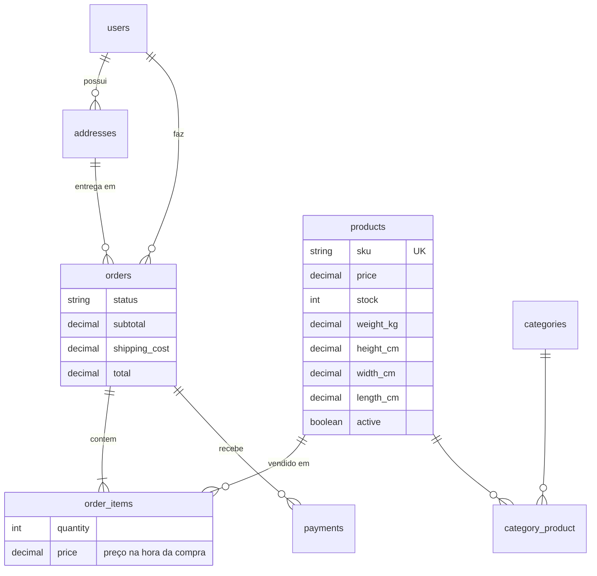

# E-commerce com integração de frete

Teste técnico para a vaga de Desenvolvedor Full Stack Júnior na Sisfrete.

API REST em Laravel: catálogo com filtros, pedidos com controle de estoque, frete cotado numa transportadora (simulada) e consultas SQL de relatório.

**Stack:** PHP 8.3+, Laravel 13, MySQL 8.4 (Docker), Sanctum, Pest.

O projeto partiu do starter kit do Laravel (Vue + Inertia). O teste está todo na API (`/api/v1`). O front não foi alterado, e só é compilado porque um teste do starter kit depende dele.

## Rodando localmente

Pré-requisitos: PHP 8.3+, Composer, Node 20+ e Docker.

```bash
git clone https://github.com/fesqueira/teste_Sisfrete.git && cd teste_Sisfrete
cp .env.example .env
docker compose up -d --wait   # MySQL, com as credenciais do .env
composer install
php artisan key:generate
php artisan migrate --seed    # categorias, produtos, clientes e pedidos dos últimos 18 meses
npm install && npm run build
php artisan serve             # http://localhost:8000/api/v1
```

Login de teste: `test@example.com` / `password`.

Porta 3306 ocupada? Mude o `DB_PORT` no `.env`. O `compose.yaml` lê o mesmo valor.

```bash
php artisan test              # 23 testes, em SQLite em memória
```

## Parte 1: modelagem



- `users` é o cliente. Uma tabela `clientes` separada duplicaria nome, email e senha.
- `addresses` não foi pedida, mas sem endereço não tem frete.
- Peso e dimensões no produto → são o que a transportadora usa para cotar (peso cúbico).
- Dinheiro em `DECIMAL(10,2)`. `FLOAT` erra centavos.
- Duas desnormalizações de propósito: `order_items.price` (o preço não pode mudar num pedido antigo) e `orders.total` (é o valor cobrado). O resto está em 3FN.
- Pagamentos 1:N → guarda a tentativa recusada e a aprovada.
- `category_product` tem PK composta. `order_items` tem dados próprios, então tem `id` e um `unique (order_id, product_id)`.
- O status é string no banco e Enum no PHP (`OrderStatus`), que guarda as transições válidas. Um `ENUM` do MySQL pediria uma migration a cada status novo.
- Cliente ou endereço com pedido não pode ser apagado (`restrict`): é histórico financeiro. Itens e pagamentos caem junto com o pedido (`cascade`).
- Índices: FKs, `unique` em email, cpf, sku, slug e transaction_id, `name` e `price` dos produtos (filtros), e `orders (user_id, created_at)` para "pedidos do cliente num período".

## Parte 2: API

Todas as rotas em `/api/v1`, com `Accept: application/json`.

| Método | Rota | Token | |
|---|---|---|---|
| POST | `/login` | | devolve o token (5 tentativas/min) |
| POST | `/logout` | ✓ | revoga o token atual |
| GET | `/me` | ✓ | usuário logado |
| GET | `/products` | | produtos ativos, com filtros e paginação |
| GET | `/products/{id}` | | um produto |
| GET | `/orders` | ✓ | pedidos do usuário |
| POST | `/orders` | ✓ | cria um pedido |
| GET | `/orders/{id}` | ✓ | um pedido (só o dono) |
| PATCH | `/orders/{id}` | ✓ | muda o status ou o endereço (só o dono) |

O catálogo é público de propósito: qualquer visitante vê os produtos, e o login é para comprar.

```bash
TOKEN=$(curl -s -X POST localhost:8000/api/v1/login -H "Accept: application/json" \
  -H "Content-Type: application/json" -d '{"email":"test@example.com","password":"password"}' \
  | php -r 'echo json_decode(stream_get_contents(STDIN))->token;')

curl -s -X POST localhost:8000/api/v1/orders -H "Accept: application/json" \
  -H "Content-Type: application/json" -H "Authorization: Bearer $TOKEN" \
  -d '{"address_id": 1, "items": [{"product_id": 1, "quantity": 2}]}'
```

**Filtros:** `GET /products?category=slug&name=cadeira&min_price=50&max_price=300&sort=price&direction=desc&per_page=20`. O `sort` aceita só `price`, `name` e `created_at` (lista branca), e o `per_page` vai até 100. Os filtros são scopes no model, e as categorias vêm com eager loading (sem N+1).

**Pedidos:**

- O preço vem do banco. Se o cliente mandar um preço, ele é ignorado.
- A criação roda numa transação, com `lockForUpdate` nos produtos. Faltou estoque num item → nada é gravado. A trava impede duas compras simultâneas da última unidade.
- O endereço tem que ser do próprio cliente.
- Fluxo do status: `pending → paid → shipped → delivered`, e `pending`/`paid` → `cancelled`. Fora disso → 422. Cancelar devolve o estoque.
- O endereço só muda com o pedido pendente.
- Uma Policy impede ver ou alterar o pedido de outro cliente (403), o que protege contra IDOR.

**Organização:** Form Requests validam, os controllers só recebem e respondem, o `OrderService` tem a regra do pedido, os API Resources definem o JSON (nenhum model sai "cru") e a `OrderPolicy` cuida da autorização.

**Erros:** sempre `{"message": "..."}`, e `errors` por campo na validação. 401 sem token, 403 sem permissão, 404 não encontrado, 422 validação ou regra de negócio, 429 excesso de login, 503 transportadora fora. Nenhuma mensagem expõe classe ou stack trace.

**Logs:**
- `storage/logs/api-AAAA-MM-DD.log`: uma linha por requisição (método, rota, status, tempo, usuário e IP), sem corpo nem token, guardada por 14 dias;
- `laravel.log`: os eventos de negócio (login, pedido criado ou atualizado, falha de frete), com contexto.

## Parte 3: SQL

Em [`database/sql/relatorios.sql`](database/sql/relatorios.sql), e os planos em [`explain.sql`](database/sql/explain.sql).

```bash
docker exec -i sisfrete-mysql mysql -usisfrete -psecret sisfrete -t < database/sql/relatorios.sql
```

**1. Pedidos e receita por cliente nos últimos 12 meses**
- `LEFT JOIN` → o cliente sem pedido aparece com 0.
- O filtro de data fica no `ON`, e não no `WHERE`. No `WHERE`, ele descartaria os clientes sem pedido e viraria um `INNER JOIN` na prática.
- A receita conta só os pedidos pagos, enviados ou entregues. O total de pedidos conta todos.

**2. Os mais vendidos por categoria**
- Uma CTE soma as vendas, e o `ROW_NUMBER() OVER (PARTITION BY categoria)` monta o top 3 de cada categoria, por quantidade (a receita desempata).
- `ROW_NUMBER` e não `RANK`: com `RANK`, um empate deixaria o top 3 com 4 itens.
- Um produto em duas categorias entra nas duas, o que é o certo para um ranking por categoria. Mas somar todas as categorias passaria da receita real.

**Índices.** Os dois relatórios já são atendidos pelos índices da modelagem: `orders (user_id, created_at)` na 1, e `order_items (order_id, product_id)` mais as FKs de produto na 2. O `EXPLAIN` da consulta 1:

| | `type` | `key` | `rows` |
|---|---|---|---|
| com o índice | `ref` | `orders_user_id_created_at_index` | 3 por cliente |
| sem (`IGNORE INDEX`) | `ALL` | — | 52, a tabela inteira |

- A ordem no índice composto importa: primeiro a igualdade (`user_id`), depois o intervalo (`created_at`).
- O MySQL reaproveita esse índice para a FK `user_id`, e por isso não existe um índice separado.
- Um índice em `orders.status` foi descartado: são 5 valores, com ~60% pagos. Como o filtro não é seletivo, ler a tabela direto sai mais barato, e o `EXPLAIN` da consulta 2 mostra exatamente isso.
- Em volume grande, um índice de cobertura `(user_id, created_at, status, total)` responderia a consulta 1 sem tocar na tabela.
- O `LIKE '%termo%'` da busca por nome não usa índice. Em volume grande, o caminho seria um `FULLTEXT`.

## Parte 4: integração de frete

Ao criar um pedido, a API cota o frete e soma ao total:

```
POST /orders → busca endereço e produtos → cota o frete (HTTP) → transação (estoque, itens, total) → 201
```

O `OrderService` depende da interface `FreightQuoter`, e o `HttpFreightQuoter` é a implementação com o HTTP Client. Trocar de transportadora = criar outra implementação.

**Simulação.** Com `FREIGHT_SIMULATE=true`, quem responde as chamadas é o `FreightApiSimulator`, via `Http::fake()`. O código real roda inteiro (timeout, retry, erros), e só a resposta é simulada. Nunca liga em produção. O preço sai do peso cúbico e da distância entre os CEPs, com origem em Marília (17500-000). O simulador falha 20% das vezes, de propósito, para exercitar o retry.

Para ver os erros sem depender da sorte:
- CEP do endereço `00000000` → transportadora fora do ar → 503, depois de 3 tentativas;
- CEP do endereço `99999999` → CEP não atendido → 422, sem nova tentativa.

**Erros de comunicação**
- Timeout de 2 s para conectar e 5 s para a resposta.
- Retry de até 3 tentativas, com espera crescente (200 ms, 400 ms), só para falha de conexão e 5xx. Um 4xx não é repetido, porque daria o mesmo erro.
- O que o cliente recebe:
  - um 4xx da transportadora → 422;
  - uma falha persistente → 503, com uma mensagem clara;
  - uma resposta sem preço ou sem prazo → 503 (nunca um pedido com frete zero).
- A chamada fica fora da transação. Esperar até 5 s por uma API externa com o estoque travado bloquearia as outras compras.
- O retry é seguro porque a cotação é idempotente: não cria nada do outro lado.

Os testes (`FreightIntegrationTest`) conferem cada cenário e quantas requisições foram feitas: 2 quando a segunda tentativa funciona, 3 quando todas falham e 1 no 4xx.

**Em produção, eu acrescentaria:**
- circuit breaker: depois de várias falhas seguidas, para de chamar por alguns minutos e responde 503 na hora;
- cache das cotações por CEP e pacotes;
- uma transportadora de reserva, aproveitando a interface;
- filas com reprocessamento para o que não precisa ser imediato (etiqueta, rastreio);
- chave de idempotência nas operações que criam algo do outro lado (contratar o frete, cobrar);
- monitoramento da taxa de erro e do tempo de resposta, com alerta;
- o token da transportadora num gerenciador de segredos, com rotação.

## Com mais tempo

- Perfil de admin: hoje o próprio cliente avança o status, o que serviu para demonstrar as transições. No mundo real, `paid` viria do gateway de pagamento e `shipped`/`delivered` da operação. O cliente só cancelaria.
- `POST /shipping/quote`, para mostrar o frete no carrinho.
- Documentação OpenAPI.
- Mensagens de validação em português.
- PHPStan (nível 7) sem pendências.
